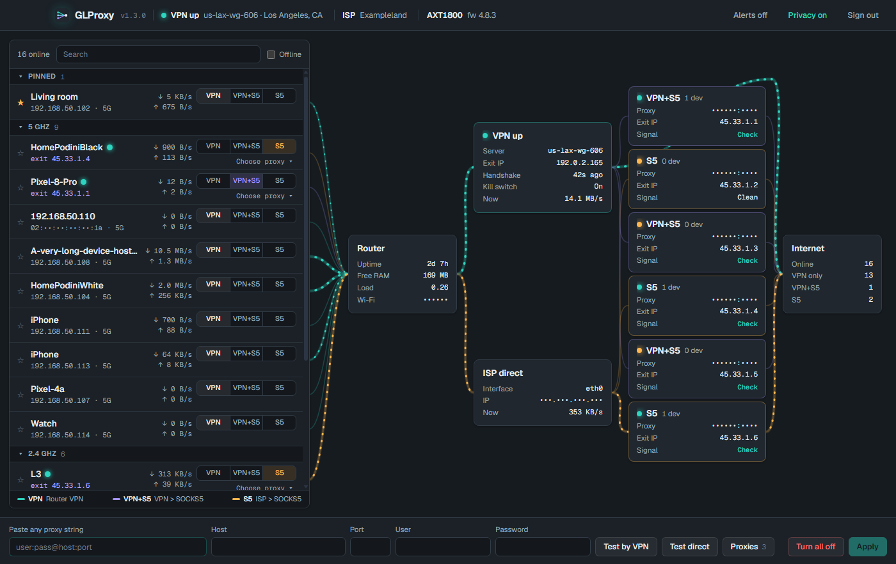
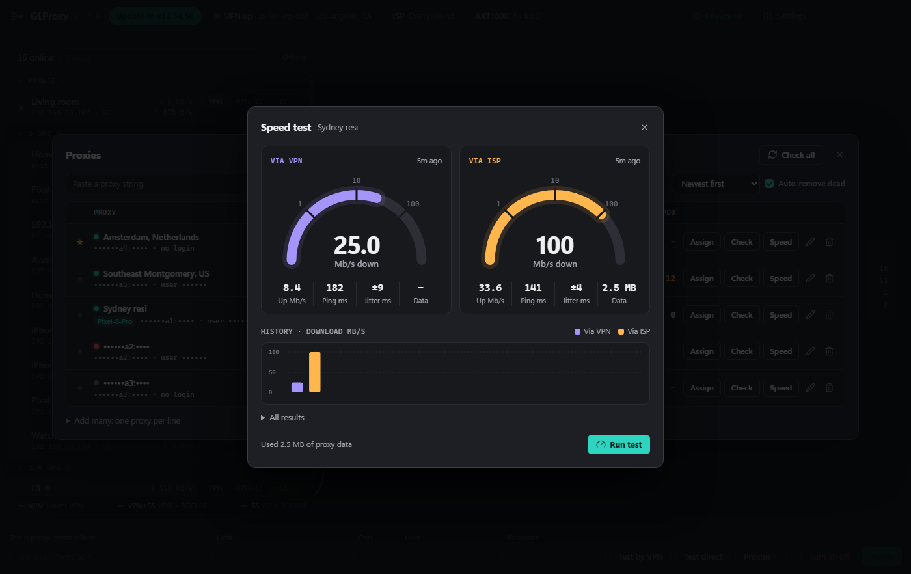

# GLProxy

Desktop app for GL.iNet and OpenWrt routers. See how each device reaches the internet, and send chosen devices through a SOCKS5 proxy.

## Download

Get the newest version from [Releases](../../releases/latest).

| Computer | File |
|---|---|
| Windows | `GLProxy-Setup-x.y.z.exe` |
| Mac, Apple silicon | `GLProxy-x.y.z-arm64.dmg` |
| Mac, Intel | `GLProxy-x.y.z.dmg` |

The apps have no paid code signature, so the system warns you the first time.

- **Windows:** select **More info**, then **Run anyway**.
- **Mac:** open the app one time. Then go to **System Settings > Privacy & Security** and select **Open Anyway**.

## What it does

- Choose a route for each device, with no change on the device.
- Use up to 6 different proxies at the same time.
- Paste a proxy in almost any format. The app reads it for you.
- Keep all your proxies in one list. Assign each one to a device from there. Pin the ones you use most.
- Test a new proxy in the bottom bar. A proxy that works is saved to the list.
- See each proxy's exit IP, city, latency, and speed through the VPN and through your ISP, with past results.
- See each exit IP's fraud scores from IPQS, Scamalytics and AbuseIPDB, each in its own column.

- Check that a device really leaves through the exit you chose.
- Hide your own IP, Wi-Fi name, proxy logins, and MAC addresses with Privacy mode. It is on by default.
- Get a notice for each new version, with what changed and a one-press update on Windows. On a Mac, the update opens this page.

## Routes

| Route | Path |
|---|---|
| VPN | Device > VPN client on the router > internet |
| Direct | Device > ISP > internet. The default with no VPN client. |
| VPN+S5 | Device > VPN > SOCKS5 > internet |
| S5 | Device > ISP > SOCKS5 > internet |

## What your router needs

- One of these systems:
  - GL.iNet firmware 4 with nftables.
  - Plain OpenWrt 22.03 or newer, 25.12 included. Flow offloading must be off: Network > Firewall > Routing/NAT Offloading.
- One of these CPUs:
  - 64-bit ARM: Flint, Flint 2, Slate AX, Beryl AX, Brume 2.
  - MIPS: Mudi (GL-E750), Slate (AR750S), Shadow, Puli.
  - Little-endian MIPS: Mango, Beryl (MT1300).
  - 32-bit ARM (ARMv7).
  - x86_64 (OpenWrt on a PC or a virtual machine).
- SSH on. The password is the router's admin password.
- A VPN client is optional.
- Internet on the router the first time you press Apply. Some routers, such as the Mudi, need a package that the app installs then.

The app stops at sign-in with a clear message if your router cannot run it.

## What has been tested

- **Tested:** GL-AXT1800, firmware 4.8.3, with a VPN client.
- **Tested in an emulator only:**
  - MIPS, OpenWrt 22.03 (the same system as the Mudi), with no VPN client.
  - Plain OpenWrt 24.10 and 25.12 on x86_64, with a WireGuard VPN and with no VPN.
- **Not tested on a real router:** plain OpenWrt, MIPS, 32-bit ARM, a router with no VPN client, and other models. Please report what you find.
- **Not supported:** stock ASUS, Netgear and TP-Link firmware, and OpenWrt-based vendor firmware such as ImmortalWrt or Teltonika RutOS. Turris OS 7 or newer works. The app says so at sign-in.

## Before you use it

- The app changes firewall rules on your router and starts two small programs there. **Turn all off** removes the routes.
- Routes stay on the router when the app is closed.
- **Signal Desk** checks an exit IP with the app owner's service. It runs only when you press Check, and each new exit IP uses one paid lookup of the owner. The service sees that exit IP and your computer's public IP.
- A speed test uses about 2.5 MB of proxy data each way. It runs only when you press Speed. An alive check uses about 1 KB.
- Your router password stays on your computer.
- Proxy logins are stored on your computer and on your router. The router uses them to connect to the proxy.

## Source

The source code is private. This repository holds the releases only.
